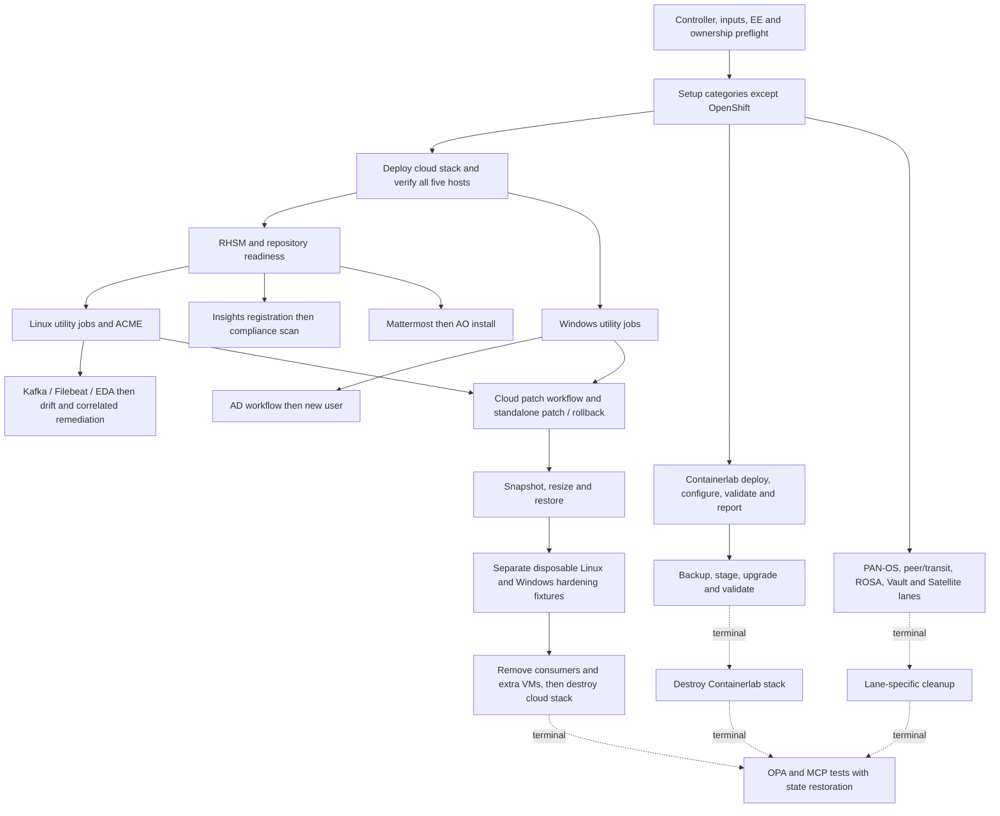

# APD integration test dependency design

This directory contains the dependency design, an executable catalog profile, and
narrower smoke profiles. Follow [FIRST-RUN.md](FIRST-RUN.md) to configure credentials, approve
the fork workflow, and review the report. The graph builder is offline; the approved
`run.py` execution configures Controller and provisions fresh fixtures. OpenShift is excluded by
source category (`openshift/setup.yml`), including its workflows. Infrastructure
templates that use a cluster remain in scope with an explicit cluster prerequisite;
they do not depend on running the broken OpenShift category setup.

## Review the graph

- [scenarios.yml](scenarios.yml) defines scenario dependencies, resource locks,
  prerequisites, ordered steps, assertions, cleanup, and documentary evidence.
- [Generated scenario graph](generated/scenario-graph.mmd) contains every scenario
  edge. Solid edges require success; dotted edges require a terminal result.
- [Configured workflow graphs](generated/workflows.md) expand all 12 workflows,
  including inventory updates, approvals, failure edges and joins.
- [Template coverage](generated/coverage.md) assigns every in-scope template to a
  planned execution. Workflow child executions count only if actually reached.
- [Machine-readable graph](generated/dependency-graph.json) combines the plan,
  exact template names, surveys, template defaults, and workflow definitions.
- [CI, approval, EE and report publishing design](ci-design.md) describes the
  Actions pipeline and explicitly binds the candidate EE under test.

The initial inventory contains **104 job templates and 12 workflow templates**.
The two APD setup templates are included in the 104. There are **34 scenarios**.
This is planned coverage, not a claim that these templates have been run.



The diagram is an overview. `scenarios.yml` is the detailed design: optional lanes
wait to become terminal before shared fixtures change, but their unavailable
prerequisites do not prevent core patching. Locks describe fixture conflicts, not
dependencies. The first runner should execute serially; later parallelism can use
independent fixtures after AWS quota/capacity checks.

## Sources and precedence

Use READMEs and linked presenter guides for cross-demo prerequisites. Use
`controller_templates` and `controller_workflows` from setup YAML for exact names,
inputs, and configured workflow routing. The builder supports both
`simplified_workflow_nodes` and `workflow_nodes`. Preserve conditional edges and
`all_parents_must_converge`; a workflow is not just a list of jobs to launch.

Record disagreements rather than silently changing a workflow or assuming the
README diagram is executable. Proposed serial orders for independent utility jobs
are test-design choices, identified as such in the plan.

### Findings that affect ordering

| Finding | Consequence for the suite | Evidence |
| --- | --- | --- |
| Cloud deploy creates RHEL9, RHEL10, two Windows hosts and `reports`. | Host consumers wait for an explicit inventory sync and SSH/WinRM readiness barrier. | [Cloud README](../../cloud/README.md) |
| Deploy's shared inventory node does not declare an all-parent join. | Do not assume its inventory sync proves all five hosts have been discovered. | [Cloud setup](../../cloud/setup.yml) |
| RHEL patch jobs can succeed while skipping work without RHSM. | Check registration, target hosts and relevant task execution, not only a green workflow. | [Patch guide](../../cloud/docs/patch-cloud-stack.md) |
| Rollback templates are not both exercised by the patch workflow. | Explicitly run both rollback templates after applicable updates; explicitly test snapshot restore. | [Cloud setup](../../cloud/setup.yml) |
| README wording puts restore after failed post-checks, but source routes restore from failed patch nodes. | Preserve source routing and report the documentation discrepancy. | [Patch README](../../cloud/README.md), [Cloud setup](../../cloud/setup.yml) |
| Compliance Enforce targets a profile-specific out-of-compliance group. | Require scan, inventory refresh, and nonempty expected membership; re-scan after remediation. | [Compliance guide](../../linux/docs/linux-compliance-workflow.md), [enforcement playbook](../../linux/remediate_out_of_compliance.yml) |
| AD provisioning also uses the common AWS network and keypair. | Complete AD consumers and delete `dc01`, `winston`, `winthrop` before shared VPC/key deletion. | [Windows setup](../../windows/setup.yml) |
| `WINDOWS / Rollback` is a debug-only playbook. | Never count the AD failure path as resource cleanup. | [Rollback source](../../windows/rollback.yml) |
| Kafka/Mattermost use shared stack networking; Destroy Cloud Stack deletes only its original five VMs. | Disable EDA and remove additional VMs before the stack destroy workflow; separately collect/delete owned snapshots and report buckets. | [Kafka](../../infrastructure/docs/config-drift-kafka.md), [Mattermost](../../infrastructure/docs/mattermost.md), [destroy guide](../../cloud/docs/cloud-destroy-stack.md) |
| Drift introduction does not itself prove EDA remediation. | Observe the EDA-triggered remediation job by worker IP and run watermark, then assert final host state. | [EDA guide](../../infrastructure/docs/config-drift-eda.md) |
| Containerlab provisioning intentionally fails if a hypervisor already exists. | Full deploy-workflow coverage needs an owned fresh fixture. An explicitly chosen reuse mode cannot claim that deploy coverage. | [Provision source](../../network/provision_hypervisor.yml) |
| Network upgrade needs a successful backup and staged matching image. | Keep baseline validation separate from the image-gated upgrade lane; validate/report after reload. | [Staging and upgrade](../../network/docs/network-staging-upgrade.md) |
| PAN-OS's configured workflow runs inventory sync and firewall configuration in parallel, then joins for webserver setup. Security-rule toggling is separate. | Follow the source graph; run deny/allow cases after the workflow. The introductory guide diagram differs. | [Network setup](../../network/setup.yml), [PAN-OS guide](../../network/docs/network-panos-workflow.md) |
| Satellite's Patch Dev hardcodes `RHEL8` and `env_RHEL8_Dev`, with a real approval node. | Provision a separate RHEL8 fixture; monitor approval while the workflow is running. Cloud RHEL9/10 workers cannot satisfy this fixture. | [Satellite setup](../../satellite/setup.yml) |
| Satellite setup automatically launches Linux setup asynchronously and SETUP / Satellite. | Bootstrap Linux first; observe setup-launched jobs and await completion rather than double-launching them. | [Satellite setup](../../satellite/setup.yml) |
| Satellite guide shows a simplified serial flow and feedback as a normal final step. | Preserve the configured parallel roots, check-mode patching, approval, and failure-only feedback nodes. | [Satellite guide](../../satellite/docs/satellite-patch-dev.md), [source](../../satellite/setup.yml) |
| AO installs and seeds other Controller templates; Network Configuration already runs on RHDP. | Test the extra template explicitly for coverage, then rediscover newly created templates and report unmapped additions. AO-native workflows need a separate adapter. | [AO guide](../../infrastructure/docs/automation-orchestrator.md) |
| OPA updates global Controller settings; MCP templates reconcile the AAP operator CR. | Run these last, capture prior state, and restore it through finalizers independent of job success. | [OPA source](../../infrastructure/opa/deploy-opa.yml), [MCP enable](../../infrastructure/aap-mcp-operator.yml) |

## Initial Controller observation

Read-only discovery on October 29, 2026, against the APD instance used for job 25:

- 110 of the 116 in-scope source templates are installed. All six missing
  templates belong to Satellite, including the `Patch Dev` workflow.
- The primary **Ansible Product Demos Inventory** has zero hosts. So does
  **Windows AD Inventory**. AWS inventory's last update succeeded, but no cloud
  stack readiness can be inferred from that status.
- **ContainerLab Inventory** has four hosts. Do not assume this is a fresh
  disposable lab or delete it merely to satisfy the deploy workflow.
- **Insights Inventory** last failed; **AD LDAP Inventory** has never updated.
  The failed OpenShift inventory sources are outside this suite's category scope.
- **Demo Job Template** is a live template with no matching APD source definition.
  Report it as unmapped. Require an explicit scenario before including it in runs.

These are observations, not permanent gates or evidence of valid credentials.
Repeat discovery at the start and end of each run. Do not persist credentials or
copy secrets from Controller into the generated graph or report.

## Proposed runner contract

1. **Discover and reconcile.** Resolve templates by organization, type and name,
   not hardcoded IDs. Compare source revision, live playbook, workflow structure,
   survey requirements, prompt flags, image selection and missing/unmapped objects.
2. **Resolve fixtures and inputs.** Bind region/owner, host patterns, reports host,
   keypairs, test users, update IDs, namespace names and credential references.
   Required survey defaults can be missing, dynamic Jinja or `REPLACEME`; template
   existence is not readiness. Call launch preflight; treat rejected/ignored launch
   fields as a configuration failure. Never silently bypass prompt settings.
3. **Schedule the scenario DAG.** `needs` requires success. `after_completion`
   waits for terminal states, including blocked optional scenarios. A blocked or
   failed prerequisite blocks descendants that require its outputs, but not
   unrelated lanes. Acquire fixture locks before each scenario.
4. **Launch roots and observe children.** A workflow is one Controller launch.
   Poll its workflow nodes and child jobs, inventory/project updates and approval
   nodes until terminal. Capture every descendant, including failures later
   handled by recovery nodes. Resolve approved test approvals while waiting.
   EDA jobs need event/time/host correlation because they are not workflow children.
5. **Assert behavior.** A successful API response is only launch acceptance.
   Require expected matched hosts, completed work and per-case assertions. Report
   empty inventories, all-skipped tasks, inapplicable patches and missing EDA
   jobs explicitly. Inventory/project updates are supporting test executions.
6. **Finalize and report.** Finalizers run after terminal consumers even on failure,
   including partially provisioned fixtures. Only owned/reconciled resources may
   be deleted. Use retained inventory of created resources, not just success output.
   Record cleanup failures and remaining resources separately from test failures.

The plan's `action`, fixture reset, assertions, cleanup adapters, trigger
observation and approval policies are **design placeholders**, not implemented
operations. No scenario is execution-ready until those adapters and an input
profile exist. Cleanup actions must themselves have failure-independent
finalizers; an ordinary success-only step sequence cannot guarantee restoration.

### Coverage and result model

Track template coverage independently from scenario status. A successful workflow
does not prove all children ran. Keep separate planned, reached, completed and
assertion-passed counts; untaken conditional branches are `not_reached`. A child
execution can cover its job template without launching another standalone copy.
Explicit rollback/restore and feedback cases cover templates hidden on failure
paths without deliberately damaging the shared fixture. Fault injection and an
OS/profile/blueprint matrix are later coverage dimensions.

Proposed report outputs are **JSON** for complete evidence, **JUnit XML** for CI,
and **HTML/Markdown** for humans. Each case/child record should include:

- Run/scenario/attempt, category, template type/name/ID, launch mode, parent
  workflow and workflow-node identifier, and source evidence.
- Controller job URL/ID, status, timestamps/duration, launch API error or rejected
  fields, expected and observed hosts, and redacted effective input references.
- Failure task/role/host, message/exception and source path, unreachable and failed
  host counts, ignored/rescued failures, and relevant bounded output excerpts.
- Source revision and EE tag plus actual resolved digest/core/collections when
  observable; otherwise label provenance unknown. Preserve compatibility warnings.
- Assertions/artifact links, dependency blocking reason, conditional-not-reached
  reason, approval evidence, EDA correlation, and independent cleanup/leak results.

Scenario outcomes: `passed`, `failed`, `blocked`, `timed_out`, `canceled`,
`skipped_by_scope`. A Controller-success/no-work run must not inflate passed
coverage. Applicability and cleanup results are separate fields. Store secrets in
environment variables or a credential provider, and redact job output because
some existing demo playbooks print tokens or passwords.

## Build and validate the design

From the repository root, with Python 3 and PyYAML available:

```bash
python tests/integration/build_graph.py
```

The builder is offline: it reads source YAML and this plan, validates every
template reference and explicit survey binding, checks evidence paths, rejects
dangling edges and dependency cycles, and requires a planned execution for every
in-scope template. It then regenerates the graph, workflow diagrams and coverage
inventory. It does not render Jinja or infer external prerequisites from job names.

Next implementation slice: add read-only Controller discovery, launch-input
preflight and report generation before implementing the first execution lane:
cloud deployment → host readiness → subscription readiness → Linux/Windows smoke
jobs → owned-resource cleanup. Expand through the remaining gated lanes once
fixture/reset/finalizer behavior is proven.

## Executable catalog preview

The CI default is now `catalog`. The fixture baseline and ownership diagnostics
are disabled for this disposable preview; native provisioning and teardown jobs
run directly. `--fixture-guard` opts local runs back into those diagnostics.

The runner follows `scenario_topological_order`, records workflow children, keeps
independent scenarios running after failures, and accounts for every non-OpenShift
template in HTML/JSON/JUnit. Missing external fixtures and adapters have explicit
blocked reasons; they never inflate reached or passed coverage. A catalog run
with blocked cases is incomplete and exits nonzero. The graph's future functional
assertions are separate from this template-execution coverage.

Workflow coverage is preferred over duplicate standalone executions. Child records
include workflow and node identity, and failed/untaken branches are not counted as
passing. The observer waits for nested children, scheduler decisions and task-event
ingestion; completion barriers protect teardown and Controller binding restoration.
Checkpoints explicitly say running/finalizing. An unresolved final snapshot is
labelled incomplete and retains the resource lease and required bindings.
