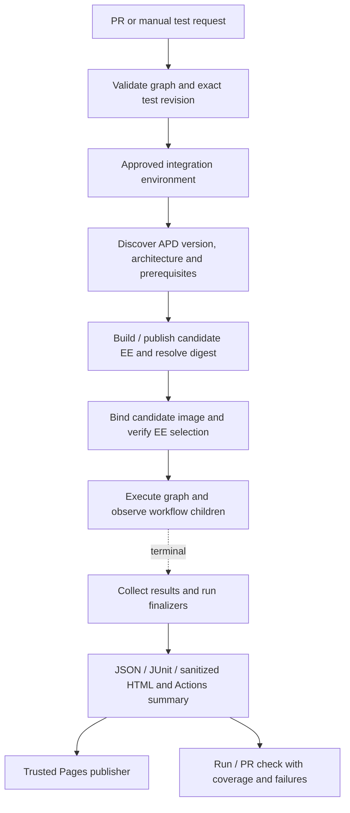

# Approved CI runs and EE provenance

Use GitHub Actions to build and execute the integration suite. A GitHub App or bot
can later provide the request/approval interface; it should call the same runner
and consume its structured report rather than inventing execution order at runtime.

The initial baseline smoke implementation is described in [FIRST-RUN.md](FIRST-RUN.md).
The broader architecture below also includes later work such as full-catalog cases,
lost-runner recovery, EE builds, Pages publishing, and a bot interface.

## Operator experience

For a preconfigured disposable APD instance, the approver provides just:

- APD Controller URL
- Username
- Password, or an optional supported API token

Store these as separate environment-scoped GitHub secrets. Passwords do not belong
in workflow inputs, PR comments, issue bodies or reports. A manual Actions run can
select an existing APD environment slot. A later bot can accept temporary credentials
through a private authenticated form/secret broker and dispatch a run using only a
credential reference. Posting a command in a PR must never require posting secrets.

The repository or service supplies policy and build configuration once: registry
push/pull access, Red Hat registry/Automation Hub credentials, allowed test profiles,
cost/time limits, test sinks and cleanup ownership rules. The approver does not
need to type those on each run. Candidate commit, AAP version, architecture,
EE definition and resulting image digest are resolved automatically.

Three connection fields cannot create missing external entitlements. Preflight
must discover whether APD already contains working AWS, machine, RHSM, Insights,
Satellite, Marketplace, ROSA and cluster credentials/resources for the selected
lanes. Report a clear blocked lane when dependencies are missing; do not treat it
as passing. The initial environment lacks Satellite templates and RHSM may require
credential completion. Profiles let core validation proceed without those lanes.

## Pipeline



Keep the orchestrator, launch policy and reporting code on a reviewed trusted
revision. Separately identify the candidate project commit and image digest under
test. A maintainer must approve the exact candidate before PR-controlled playbooks
or build steps receive instance access or build credentials. If the PR head
changes, invalidate that approval and require a new run. Do not automatically run
fork code with privileged `pull_request_target` access.

Use an APD-slot concurrency lock with cancellation disabled for active runs.
Also maintain a server-side lease/run ledger: a manual command or bot must not
bypass the lock. Reconcile old owned resources and incomplete runs before reusing
a slot. Check connectivity before reserving a slot; use an ephemeral runner with
appropriate network access when APD is not reachable from hosted runners.

The long suite should be resumable by scenario and split into bounded profiles:
smoke, core, network and externally gated coverage. These profiles select subgraphs
and still report missing coverage against the full template inventory. Completion
of a small profile is not a claim of full-catalog success. Preserve the ledger
between jobs so collection and cleanup can resume after runner interruption;
`always()` alone cannot guarantee cleanup after cancellation or runner loss.

## Treat the EE as a test input

The tested unit is a tuple:

```text
candidate project commit + EE definition/requirements + published image digest
+ AAP version + execution architecture + scenario/input profile
```

Build an EE even for playbook-only changes, or reuse an artifact with matching
recorded build provenance. Resolve mutable build inputs and record the actual base
image digest and installed dependency versions. Publish under an immutable
candidate identifier and pass a digest reference to Controller. Never select
`latest` as an implicit fallback. An already published candidate image may also be
supplied explicitly for reproduction.

The repository supports `apd_ee_image` in
[`common/bootstrap-vars.yml`](../../common/bootstrap-vars.yml), but changing only
that setting is insufficient:

- **LINUX / Fact Scan** and **LINUX / Patching** explicitly select
  `Default execution environment`.
- **Cloud / AWS / VPC Report** explicitly selects `TMM AWS EE`.
- Other templates inherit organization/project defaults.
- Setup and AO seeding can create templates or restore their source EE choices.

Enforce the binding map in [`scenarios.yml`](scenarios.yml), not merely the
Product Demos EE image:

1. Create a run-owned candidate EE record using its digest and required registry
   credential. Record previous organization/project/template settings.
2. Bind APD setup templates before their first launch. Set relevant project and
   organization defaults, then explicitly bind every ordinary job template to the
   candidate, including the legacy overrides above.
3. After each category setup or seeding operation, rediscover templates and
   reapply the map. Before each launch, check the effective binding again.
4. Bind child job templates directly so workflows actually use the candidate.
   Passing `execution_environment` at launch is insufficient when prompting is
   disabled and does not reliably enforce workflow-child selection.
5. Bind eligible inventory/project updates too. Record explicit platform-required
   supporting-runtime exceptions instead of counting them as candidate executions.
6. Resolve specialized AO and ROSA images to declared digests. Their jobs need
   separate tools; preserve their declared runtime and report coverage separately.
   A multi-image suite manifest makes this visible rather than silently replacing
   all runtimes with one unsuitable image.
7. Use an appropriate pull policy and verify every resulting job's EE record
   still resolves to the expected digest. Correlate actual container-image evidence
   when available. If Controller exposes only a tag/EE ID, label runtime digest
   evidence unverified; an EE name is not proof of the image that ran.
8. Include a diagnostic execution for core, collection and tool versions before
   scenario work. Capture warnings and fail EE provenance on wrong-image jobs.
   Restore recorded configuration through failure-independent finalizers.

The generated graph assigns a planned runtime to all 104 job templates: 97 use
the candidate APD EE and seven use specialized AO/ROSA EEs. Workflow templates
are orchestration objects; runtime provenance belongs to their actual child jobs.
Report the tested architecture only; a multi-architecture image build alone does
not prove acceptance on every platform.

## Reports and Pages

Start with Actions job summaries and JSON/JUnit/HTML artifacts, including reports
from failed runs. Render reports in a separate trusted step. Keep raw evidence in
the authenticated system with suitable access/retention; never assume an Actions
artifact in a public repository is confidential. Redact artifacts too.

Publish only an allowlisted summary: source SHA, candidate digest, architecture,
template/scenario names, statuses, durations, coverage, sanitized error summaries,
warnings and cleanup outcome. Escape all job-supplied strings. Do not publish raw
stdout, extra vars, passwords, tokens, private keys or environment dumps; several
existing demo jobs print credentials. GitHub's exact-value masking does not cover
every generated secret or transformation.

This repository already deploys its documentation site through
[`.github/workflows/jekyll-gh-pages.yml`](../../.github/workflows/jekyll-gh-pages.yml).
A report-only deployment in this repository must not overwrite that site.
Choose a dedicated report repository/site or one publisher that assembles
documentation and retained report history into a complete Pages artifact.
Deploying `reports/<run-id>` alone does not merge files into a previous deployment.

A dedicated report site is the initial recommendation. Its publisher receives
validated structured data from approved runs and renders its own HTML; it never
executes candidate-supplied scripts with publishing rights. Persist a bounded run
index/history outside transient workspace state before building each complete
site artifact. Serialize deployments to avoid lost updates. Suggested paths:
`runs/<run-id>/`, `prs/<number>/`, and the latest approved main run.

## Bot responsibilities

A later GitHub App can request a run for a PR SHA, reserve an APD slot, present
the exact scope and EE build for approval, dispatch the trusted workflow, and
update its check/report link. Authenticate the requester and recheck authorization
at dispatch. PR text is data, not an execution policy. A bot may also summarize
failures or prepare a fix PR as a separate task, but test verdicts should come from
deterministic assertions and Controller evidence.

Actions plus the Python runner should come first. The bot becomes another entry
point into that system without duplicating scheduling or test logic.

## Implementation order

1. Add candidate EE mapping/provenance and read-only Controller preflight.
2. Implement the core fixture lifecycle, execution tracking, assertions and cleanup.
3. Wrap the local CLI in an approved manual Actions workflow with environment
   secrets, slot locking and artifact/job-summary output.
4. Add trusted sanitized-report publishing while preserving the docs site.
5. Add the bot/credential broker once the run contract and failure recovery work.

References: [GitHub environment protection and secrets](https://docs.github.com/en/actions/how-tos/deploy/configure-and-manage-deployments/manage-environments),
[secure workflow use](https://docs.github.com/en/actions/reference/security/secure-use),
and [custom Pages workflows](https://docs.github.com/en/pages/getting-started-with-github-pages/using-custom-workflows-with-github-pages).
