# Configured workflow graphs

Generated from setup YAML, including conditional edges and join behavior.

## Deploy Cloud Stack in AWS

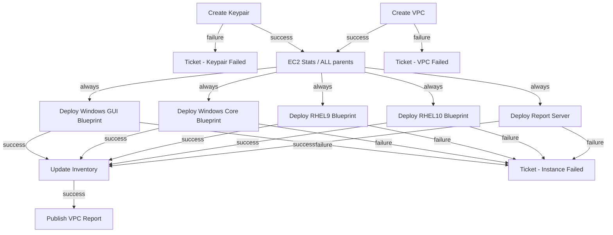

| Node | Type | Target |
| --- | --- | --- |
| Create Keypair | job_template | Cloud &#124; AWS &#124; Create Keypair |
| Create VPC | job_template | Cloud &#124; AWS &#124; Create VPC |
| Ticket - Keypair Failed | job_template | SUBMIT FEEDBACK |
| EC2 Stats | job_template | Cloud &#124; AWS &#124; Display EC2 Stats |
| Deploy Windows GUI Blueprint | job_template | Cloud &#124; AWS &#124; Create VM |
| Deploy Windows Core Blueprint | job_template | Cloud &#124; AWS &#124; Create VM |
| Deploy RHEL9 Blueprint | job_template | Cloud &#124; AWS &#124; Create VM |
| Deploy RHEL10 Blueprint | job_template | Cloud &#124; AWS &#124; Create VM |
| Deploy Report Server | job_template | Cloud &#124; AWS &#124; Create VM |
| Update Inventory | inventory_source | AWS Inventory |
| Ticket - Instance Failed | job_template | SUBMIT FEEDBACK |
| Publish VPC Report | job_template | Cloud &#124; AWS &#124; VPC Report |
| Ticket - VPC Failed | job_template | SUBMIT FEEDBACK |

## Destroy Cloud Stack in AWS

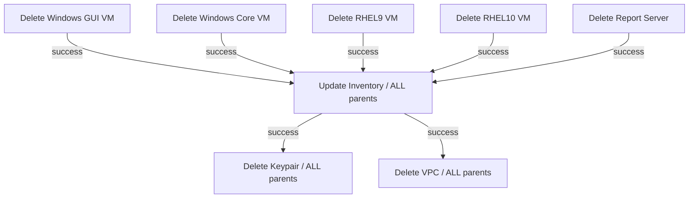

| Node | Type | Target |
| --- | --- | --- |
| Delete Windows GUI VM | job_template | Cloud &#124; AWS &#124; Delete Stack VM |
| Delete Windows Core VM | job_template | Cloud &#124; AWS &#124; Delete Stack VM |
| Delete RHEL9 VM | job_template | Cloud &#124; AWS &#124; Delete Stack VM |
| Delete RHEL10 VM | job_template | Cloud &#124; AWS &#124; Delete Stack VM |
| Delete Report Server | job_template | Cloud &#124; AWS &#124; Delete Stack VM |
| Update Inventory | inventory_source | AWS Inventory |
| Delete Keypair | job_template | Cloud &#124; AWS &#124; Delete Keypair |
| Delete VPC | job_template | Cloud &#124; AWS &#124; Delete VPC |

## Patch Cloud Stack in AWS

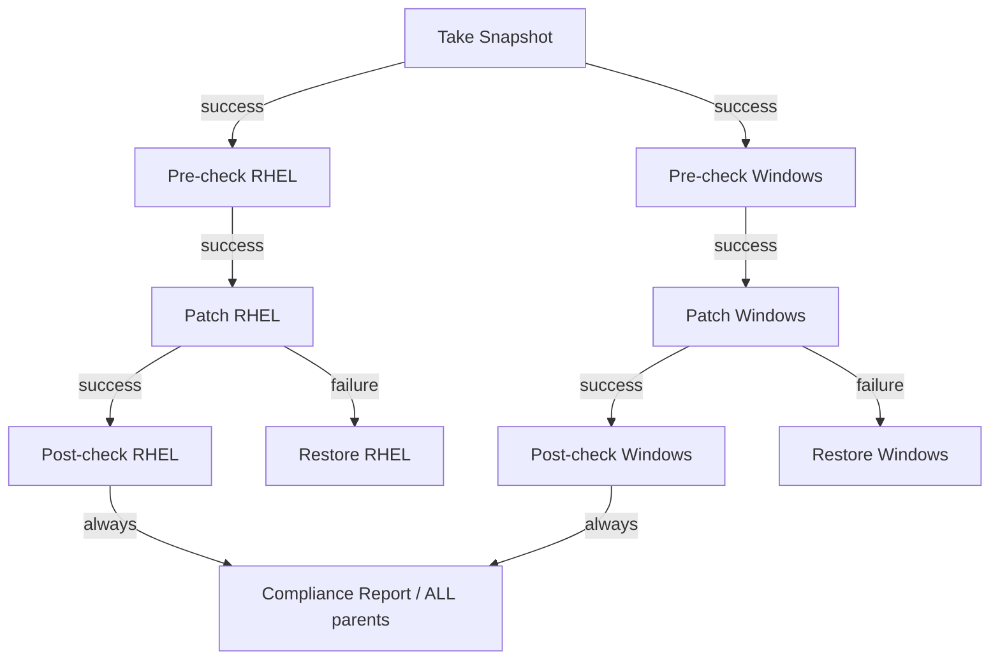

| Node | Type | Target |
| --- | --- | --- |
| Take Snapshot | job_template | Cloud &#124; AWS &#124; Snapshot EC2 |
| Pre-check RHEL | job_template | Cloud &#124; AWS &#124; Patch Pre-check RHEL |
| Pre-check Windows | job_template | Cloud &#124; AWS &#124; Patch Pre-check Windows |
| Patch RHEL | job_template | Cloud &#124; AWS &#124; Patch RHEL |
| Patch Windows | job_template | Cloud &#124; AWS &#124; Patch Windows |
| Post-check RHEL | job_template | Cloud &#124; AWS &#124; Patch Post-check RHEL |
| Restore RHEL | job_template | Cloud &#124; AWS &#124; Restore EC2 from Snapshot |
| Post-check Windows | job_template | Cloud &#124; AWS &#124; Patch Post-check Windows |
| Restore Windows | job_template | Cloud &#124; AWS &#124; Restore EC2 from Snapshot |
| Compliance Report | job_template | Cloud &#124; AWS &#124; Patch Compliance Report |

## Infrastructure | ROSA - Lifecycle (Create)

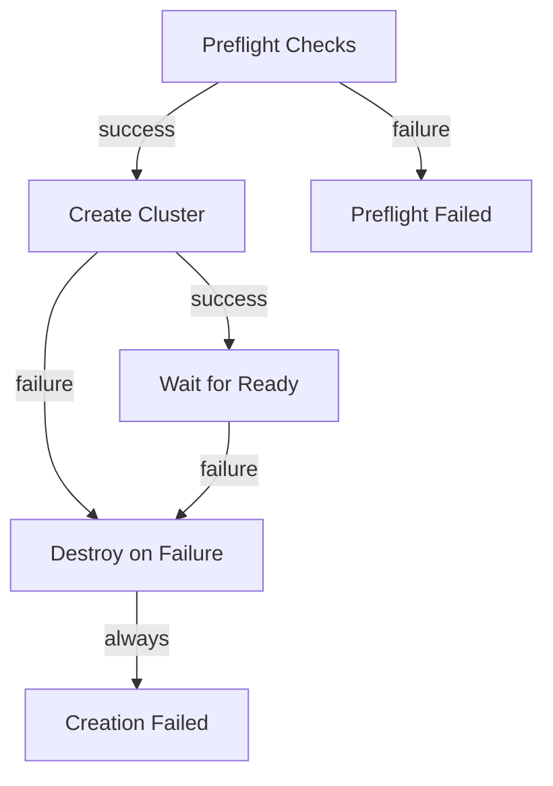

| Node | Type | Target |
| --- | --- | --- |
| Preflight Checks | job_template | Infrastructure &#124; ROSA - Preflight Checks |
| Create Cluster | job_template | Infrastructure &#124; ROSA - Create Cluster |
| Wait for Ready | job_template | Infrastructure &#124; ROSA - Wait for Ready |
| Destroy on Failure | job_template | Infrastructure &#124; ROSA - Destroy Cluster |
| Preflight Failed | job_template | SUBMIT FEEDBACK |
| Creation Failed | job_template | SUBMIT FEEDBACK |

## Infrastructure | ROSA - Lifecycle (Destroy)

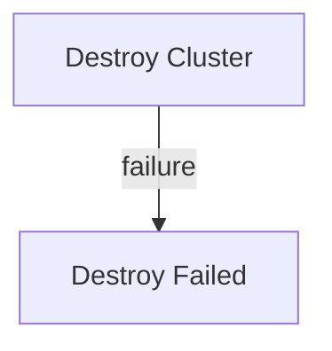

| Node | Type | Target |
| --- | --- | --- |
| Destroy Cluster | job_template | Infrastructure &#124; ROSA - Destroy Cluster |
| Destroy Failed | job_template | SUBMIT FEEDBACK |

## Infrastructure | Config Drift - Full Setup

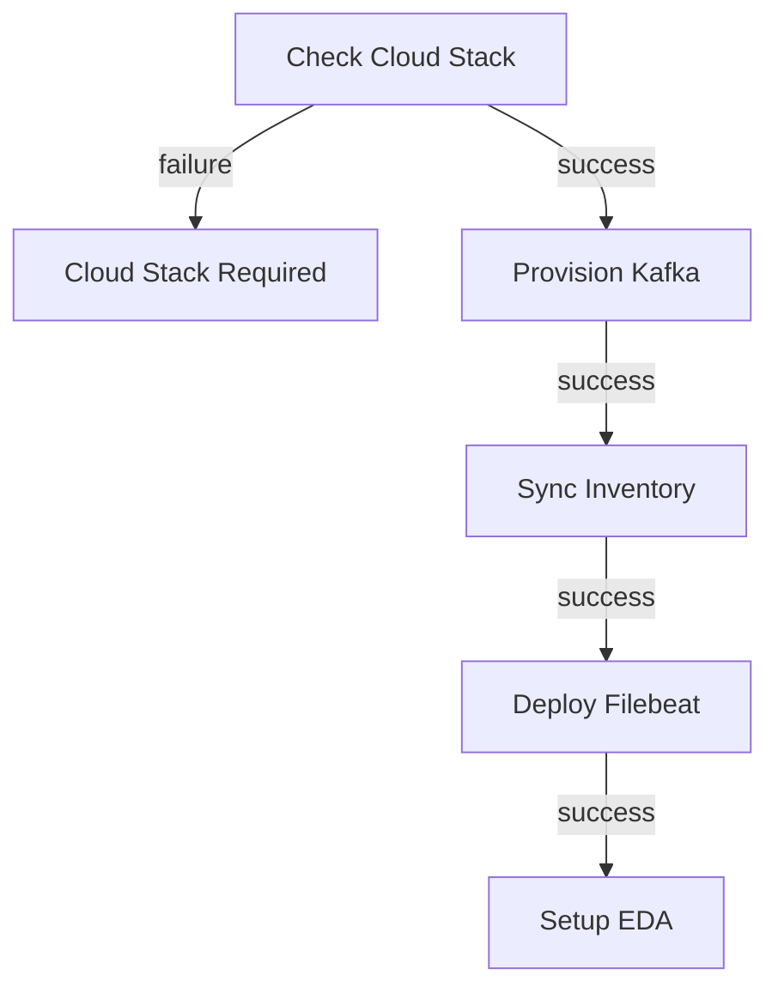

| Node | Type | Target |
| --- | --- | --- |
| Check Cloud Stack | job_template | Infrastructure &#124; Config Drift - Check Cloud Stack |
| Cloud Stack Required | job_template | SUBMIT FEEDBACK |
| Provision Kafka | job_template | Infrastructure &#124; AWS - Provision Kafka Queue |
| Sync Inventory | inventory_source | AWS Inventory |
| Deploy Filebeat | job_template | LINUX &#124; Config Drift - Deploy Audit and Filebeat |
| Setup EDA | job_template | Infrastructure &#124; Setup Rulebook for Kafka Queue - Config Drift & Remediation |

## Linux | Compliance Workflow

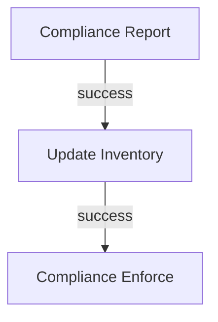

| Node | Type | Target |
| --- | --- | --- |
| Compliance Report | job_template | LINUX &#124; Multi-profile Compliance Report |
| Update Inventory | inventory_source | AWS Inventory |
| Compliance Enforce | job_template | LINUX &#124; Compliance Enforce |

## NETWORK | Panos | Demo Firewall Workflow

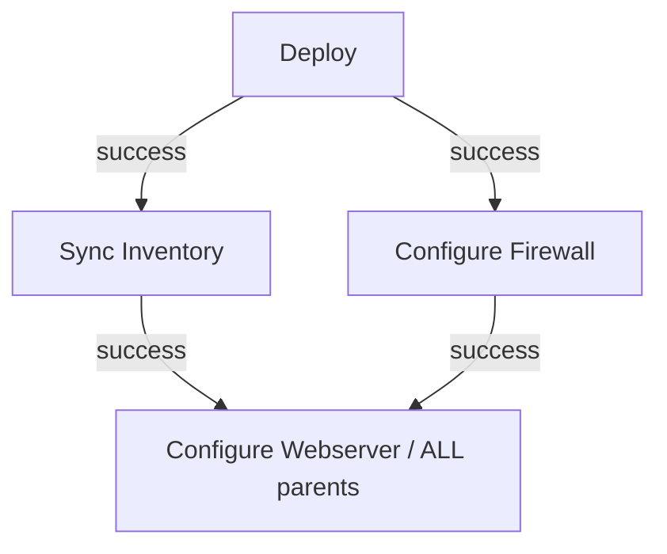

| Node | Type | Target |
| --- | --- | --- |
| Deploy | job_template | NETWORK &#124; Panos &#124; Deploy |
| Sync Inventory | inventory_source | Panos Demo Instances |
| Configure Firewall | job_template | NETWORK &#124; Panos &#124; Configure Firewall |
| Configure Webserver | job_template | NETWORK &#124; Panos &#124; Configure Webserver |

## NETWORK | Deploy Containerlab Stack

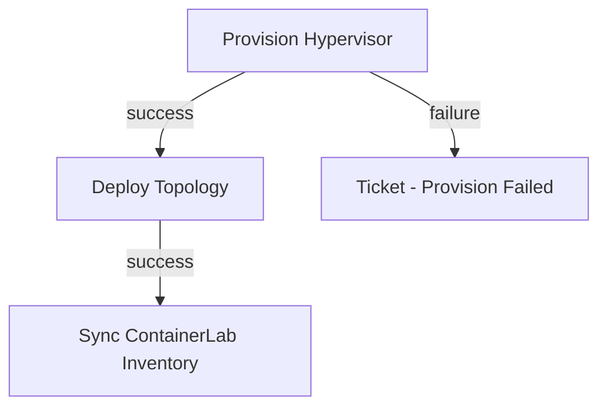

| Node | Type | Target |
| --- | --- | --- |
| Provision Hypervisor | job_template | NETWORK &#124; Containerlab &#124; Provision Hypervisor |
| Deploy Topology | job_template | NETWORK &#124; Containerlab &#124; Deploy Topology |
| Sync ContainerLab Inventory | inventory_source | ContainerLab Hypervisor |
| Ticket - Provision Failed | job_template | SUBMIT FEEDBACK |

## NETWORK | Destroy Containerlab Stack

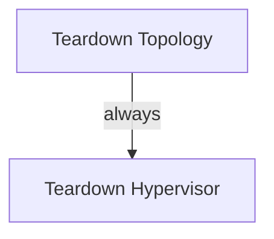

| Node | Type | Target |
| --- | --- | --- |
| Teardown Topology | job_template | NETWORK &#124; Containerlab &#124; Teardown Topology |
| Teardown Hypervisor | job_template | NETWORK &#124; Containerlab &#124; Teardown Hypervisor |

## Patch Dev

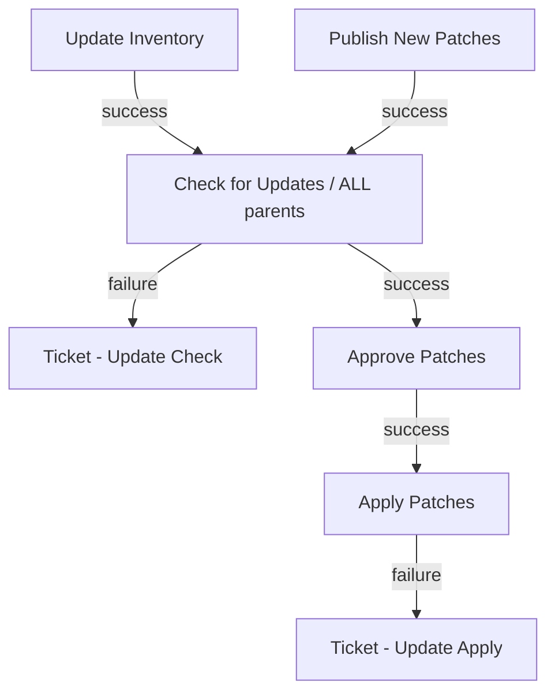

| Node | Type | Target |
| --- | --- | --- |
| Update Inventory | inventory_source | Satellite Inventory |
| Publish New Patches | job_template | SATELLITE &#124; Publish Content View Version |
| Check for Updates | job_template | LINUX &#124; Patching |
| Ticket - Update Check | job_template | SUBMIT FEEDBACK |
| Approve Patches | workflow_approval | Push patches to Dev? |
| Apply Patches | job_template | LINUX &#124; Patching |
| Ticket - Update Apply | job_template | SUBMIT FEEDBACK |

## Setup Active Directory Domain

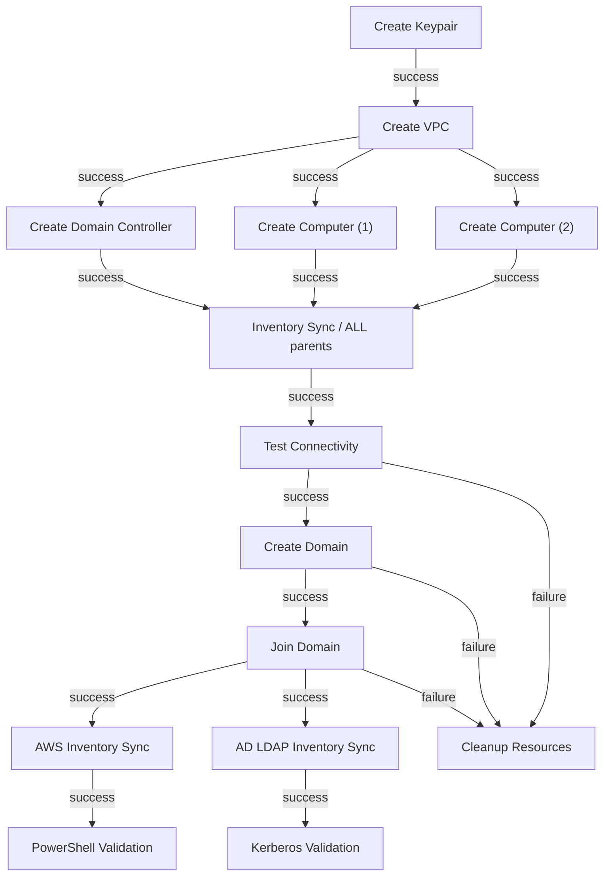

| Node | Type | Target |
| --- | --- | --- |
| Create Keypair | job_template | Cloud &#124; AWS &#124; Create Keypair |
| Create VPC | job_template | Cloud &#124; AWS &#124; Create VPC |
| Create Domain Controller | job_template | Cloud &#124; AWS &#124; Create VM |
| Create Computer (1) | job_template | Cloud &#124; AWS &#124; Create VM |
| Create Computer (2) | job_template | Cloud &#124; AWS &#124; Create VM |
| Inventory Sync | inventory_source | AWS Inventory |
| Test Connectivity | job_template | WINDOWS &#124; Test Connectivity |
| Create Domain | job_template | WINDOWS &#124; AD &#124; Create Domain |
| Join Domain | job_template | WINDOWS &#124; AD &#124; Join Domain |
| AWS Inventory Sync | inventory_source | AWS Inventory |
| AD LDAP Inventory Sync | inventory_source | AD LDAP Inventory |
| Cleanup Resources | job_template | WINDOWS &#124; Rollback |
| PowerShell Validation | job_template | WINDOWS &#124; Run PowerShell |
| Kerberos Validation | job_template | WINDOWS &#124; Run PowerShell &#124; Kerberos |
